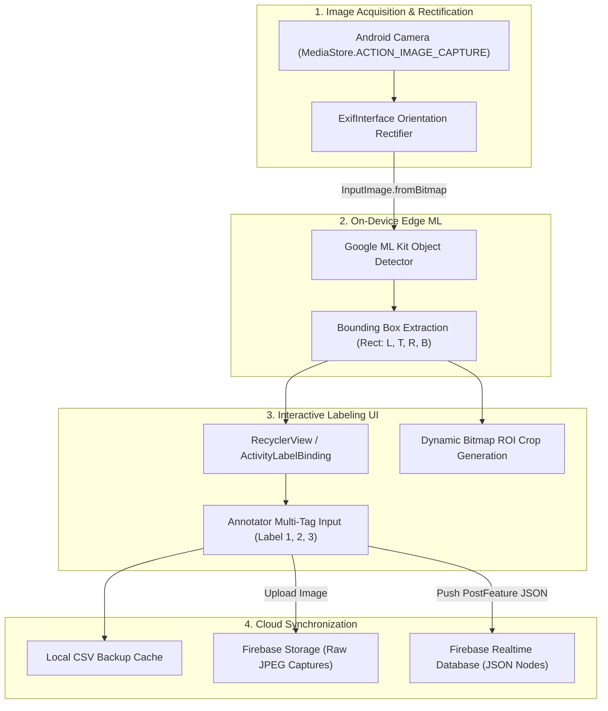

English | [繁體中文](README_zh.md)

# Mobile Computer Vision Data Labeling Tool

[](https://developer.android.com/)
[](https://kotlinlang.org/)
[](https://developers.google.com/ml-kit)
[](https://firebase.google.com/)
[](https://gradle.org/)
[](https://www.apache.org/licenses/LICENSE-2.0)

An intelligent, on-device data labeling and annotation application for Android devices. Built with **Kotlin**, **Google ML Kit (Object Detection & Tracking)**, and **Firebase Cloud Services**, this tool allows computer vision engineers and dataset annotators to capture images, automatically detect objects, extract bounding-box ROIs (Regions of Interest), assign multi-class labels, and stream synchronized datasets directly to cloud storage.

---

## Table of Contents

- [Overview](#overview)
- [Key Features](#key-features)
- [Application Screenshots](#application-screenshots)
- [System Architecture & Processing Pipeline](#system-architecture--processing-pipeline)
- [Data Models & Schema](#data-models--schema)
- [Directory Structure](#directory-structure)
- [Prerequisites & Environment](#prerequisites--environment)
- [Firebase Setup & Configuration](#firebase-setup--configuration)
- [Build & Installation Guide](#build--installation-guide)
- [Demonstration Video](#demonstration-video)
- [Roadmap](#roadmap)
- [Trademarks & Disclaimer](#trademarks--disclaimer)
- [License](#license)

---

## Overview

Collecting high-quality bounding-box datasets for computer vision in warehouse, retail, or field environments usually demands awkward round-trips: taking pictures on cameras or mobile phones, transferring them to desktop workstations, and running heavy desktop annotation suites (e.g., LabelImg, CVAT).

**Mobile Computer Vision Data Labeling Tool** streamlines this workflow into a single handheld device:
1. Captures high-resolution imagery via Android CameraX / Camera intent with automatic EXIF orientation rectification.
2. Runs lightweight, on-device machine learning inference via Google ML Kit to locate candidate objects and generate initial 2D bounding boxes (`Rect`).
3. Crops close-up object patches automatically for inspection.
4. Provides an intuitive mobile annotation interface allowing annotators to attach up to three hierarchical or attribute tags per object.
5. Uploads raw images to Firebase Cloud Storage and synchronized annotations to Firebase Realtime Database in real time.

---

## Key Features

- **On-Device Edge AI Detection**: Powered by Google ML Kit Object Detection API (`com.google.mlkit:object-detection`), detecting single or multiple objects with zero server latency or cloud inference cost.
- **Automated ROI Cropping**: Automatically calculates bounding coordinates (`left`, `top`, `right`, `bottom`) and extracts high-resolution crops of each detected object.
- **Multi-Attribute Labeling**: Annotate each detected instance with 1–3 custom semantic tags (e.g., Category, State, Color).
- **EXIF-Aware Image Ingestion**: Fully resolves camera sensor orientation metadata (`ExifInterface`) to prevent aspect-ratio distortions and bounding box coordinate misalignment.
- **Real-Time Cloud Synchronization**: Dual-channel Firebase architecture:
  - **Firebase Storage**: Stores original full-resolution captures as `JPEG_YYYYMMDD_HHMMSS`.
  - **Firebase Realtime Database**: Streams structured JSON annotation nodes with unique push keys.
- **Offline Safeguard**: Exports local CSV backup tables before pushing telemetry over network channels.

---

## Application Screenshots

| 1. Capture | 2. ML Kit Detection | 3. Multi-Label Tagging | 4. Sync Complete | 5. ROI Crop Inspection |
| :---: | :---: | :---: | :---: | :---: |
|  |  |  |  |  |

---

## System Architecture & Processing Pipeline



---

## Data Models & Schema

### Cloud Storage File Conventions
- Raw images are stored in Firebase Storage root or designated folder:
  `JPEG_<yyyyMMdd_HHmmss>.jpg` (e.g., `JPEG_20211009_143022.jpg`)

### Realtime Database JSON Structure
Each detected and annotated bounding box is indexed under an autogenerated Firebase Push Key:

```json
{
  "-MlJ27Vsisfl9O9TcNfY": {
    "uid": "JPEG_20211009_143022.jpg",
    "top": "2040",
    "bottom": "2990",
    "left": "213",
    "right": "1159",
    "label1": "Keyboard",
    "label2": "Mechanical",
    "label3": "Black"
  }
}
```

### Kotlin Data Class (`models.PostFeature`)

```kotlin
data class PostFeature(
    var uid: String? = "",      // Reference to source photo identifier
    var left: String? = "",     // Bounding box X-min coordinate (pixels)
    var top: String? = "",      // Bounding box Y-min coordinate (pixels)
    var right: String? = "",    // Bounding box X-max coordinate (pixels)
    var bottom: String? = "",   // Bounding box Y-max coordinate (pixels)
    var label1: String? = "",   // Primary category tag
    var label2: String? = "",   // Secondary attribute tag
    var label3: String? = ""    // Tertiary attribute tag
)
```

---

## Directory Structure

```text
APP-data-labeling-tools/
├── app/                                        # Android application module
│   ├── build.gradle                            # Module build configuration & dependencies
│   ├── google-services.json                    # Firebase service configuration
│   ├── proguard-rules.pro                      # ProGuard / R8 obfuscation rules
│   └── src/
│       └── main/
│           ├── AndroidManifest.xml             # Android permissions & activity declarations
│           ├── java/
│           │   ├── com/google/mlkit/codelab/objectdetection/
│           │   │   ├── MainActivity.kt         # Camera ingestion, EXIF correction, preview
│           │   │   └── LabelActivity.kt        # ML Kit inference, cropping, UI tagging, cloud sync
│           │   └── models/
│           │       └── PostFeature.kt          # Bounding box & label data transfer model
│           └── res/                            # Android layouts, drawables, and values
├── gradle/                                     # Gradle wrapper binaries & properties
├── build.gradle                                # Root project build script
├── gradle.properties                           # JVM & AndroidX configuration flags
├── gradlew / gradlew.bat                       # Gradle wrapper execution scripts
├── README.md                                   # English documentation
├── README_zh.md                                # Traditional Chinese documentation
└── 1.jpg .. 5.jpg                              # User interface screenshot assets
```

---

## Prerequisites & Environment

- **Operating System**: Windows 10/11, macOS, or Ubuntu Linux
- **IDE**: Android Studio 4.2+ (Arctic Fox / Bumblebee / Iguana recommended)
- **Android Target**:
  - `compileSdkVersion`: 30 (Android 11)
  - `targetSdkVersion`: 30
  - `minSdkVersion`: 23 (Android 6.0 Marshmallow)
- **Java Development Kit**: JDK 1.8 / Java 8 or Java 11
- **Physical Device**: Android phone with camera hardware (emulator camera supported for testing)

---

## Firebase Setup & Configuration

1. Visit the [Firebase Console](https://console.firebase.google.com/) and create a project.
2. Register an Android Application with Package Name: `com.google.mlkit.codelab.objectdetection`.
3. Download the generated `google-services.json` configuration file and place it in the `app/` directory.
4. Enable **Firebase Storage**:
   - In the Firebase Console, navigate to **Build > Storage** and initialize a bucket.
   - For internal development, use permissive security rules:
     ```javascript
     rules_version = '2';
     service firebase.storage {
       match /b/{bucket}/o {
         match /{allPaths=**} {
           allow read, write: if true;
         }
       }
     }
     ```
5. Enable **Firebase Realtime Database**:
   - Navigate to **Build > Realtime Database** and create a database instance.
   - For internal testing, configure read/write permissions:
     ```json
     {
       "rules": {
         ".read": true,
         ".write": true
       }
     }
     ```

---

## Build & Installation Guide

### Step 1: Clone the Repository
```bash
git clone https://github.com/Max97k/APP-data-labeling-tools.git
cd APP-data-labeling-tools
```

### Step 2: Assemble Debug APK via CLI
Using the Gradle wrapper:
```bash
# On Linux / macOS
./gradlew assembleDebug

# On Windows PowerShell / CMD
.\gradlew.bat assembleDebug
```

The output APK will be generated at `app/build/outputs/apk/debug/app-debug.apk`.

### Step 3: Deploy to Device
```bash
adb install -r app/build/outputs/apk/debug/app-debug.apk
```
Or open the project directly inside **Android Studio** and click **Run 'app'** (`Shift + F10`).

---

## Demonstration Video

Watch the complete demonstration walkthrough on YouTube:
[](https://youtu.be/3dlyRlCIImk)

---

## Roadmap

- [ ] Interactive on-screen manual bounding box adjustment with pinch-to-zoom gestures.
- [ ] Export directly to standardized dataset formats (COCO JSON, Pascal VOC XML, YOLO `.txt`).
- [ ] Multi-user session authentication and synchronized team tagging pools.
- [ ] Arbitrary dynamic tag counts (tag lists exceeding 3 attributes).
- [ ] Offline caching with background queue sync using Android WorkManager.

---

## Trademarks & Disclaimer

- **Android®** and **Google ML Kit™** are trademarks of Google LLC.
- **Firebase®** is a registered trademark of Google LLC.
- **Kotlin®** is a trademark of the Kotlin Foundation.
- This repository is an independent open-source developer project and is not officially affiliated with or endorsed by Google LLC.

---

## License

This project is distributed under the [Apache License, Version 2.0](https://www.apache.org/licenses/LICENSE-2.0).
