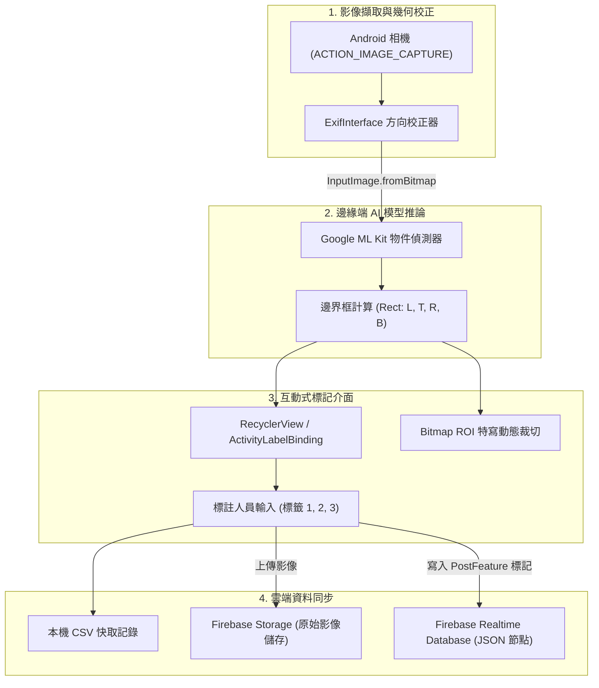

[English](README.md) | 繁體中文

# 行動端電腦視覺物件標註工具 (Mobile Data Labeling Tool)

[](https://developer.android.com/)
[](https://kotlinlang.org/)
[](https://developers.google.com/ml-kit)
[](https://firebase.google.com/)
[](https://gradle.org/)
[](https://www.apache.org/licenses/LICENSE-2.0)

專為 Android 行動裝置設計的智慧邊緣端影像資料標記與邊界框（Bounding Box）標註工具。系統採用 **Kotlin** 語言開發，結合 **Google ML Kit（物件偵測與追蹤 API）** 以及 **Firebase 雲端服務**，讓電腦視覺工程師與標記人員在實體場域能直接以手機完成照片拍攝、本機邊緣端 AI 自動偵測、感興趣區域（ROI）特寫裁切、多層級標籤輸入，並無縫將資料同步至雲端資料庫。

---

## 目錄

- [系統概述](#系統概述)
- [核心功能特色](#核心功能特色)
- [應用程式操作截圖](#應用程式操作截圖)
- [系統架構與處理管線](#系統架構與處理管線)
- [資料模型與儲存格式](#資料模型與儲存格式)
- [專案目錄結構](#專案目錄結構)
- [前置需求與環境規格](#前置需求與環境規格)
- [Firebase 雲端後端配置](#firebase-雲端後端配置)
- [建置與安裝步驟](#建置與安裝步驟)
- [操作示範影片](#操作示範影片)
- [未來展望與開發藍圖](#未來展望與開發藍圖)
- [商標宣告與免責聲明](#商標宣告與免責聲明)
- [授權條款](#授權條款)

---

## 系統概述

在倉儲物料辨識、零售貨架分析及戶外場域中，收集電腦視覺邊界框（Bounding Box）訓練資料集時，傳統流程通常需要先以相機或手機拍照，再將照片傳回桌面工作站，透過 LabelImg 或 CVAT 等工具耗時標註。

**行動端電腦視覺物件標註工具** 將整個流程整合至單一行動裝置：
1. 透過相機直接拍照，並透過 `ExifInterface` 智慧校正拍攝方向與旋轉角度。
2. 於行動裝置本地端運行 Google ML Kit 機器學習模型，即時偵測畫面中候選物件並產生初階 2D 邊界框（`Rect`）。
3. 依據邊界框自動裁切物件的高解析度特寫影像（ROI）。
4. 提供直覺化的互動標籤介面，允許標註員為每個候選框輸入最多 3 組屬性標籤（例如：類別、外觀狀態、顏色）。
5. 同步將原始照片推播至 Firebase Cloud Storage，並將結構化 JSON 標記寫入 Firebase Realtime Database。

---

## 核心功能特色

- **邊緣端即時 AI 偵測**：整合 Google ML Kit 物件偵測 API（`com.google.mlkit:object-detection`），於手機晶片直接推論，零伺服器延遲、不消耗雲端運算配額。
- **自動化 ROI 特寫裁切**：精確計算物體座標邊界（`left`, `top`, `right`, `bottom`），自動輸出子圖層供標註者檢驗。
- **多屬性標籤管理**：每個物件支援 1 至 3 個語意標籤輸入，彈性適應階層式分類需求。
- **EXIF 方向自我校正**：完整解析相機感測器方向中繼資料（`ExifInterface`），徹底消除照片旋轉引起的長寬比扭曲與標註框座標位移。
- **即時雲端雙軌同步**：
  - **Firebase Storage**：永久保存原始 Full-HD 照片，檔名依時間戳記命名（`JPEG_YYYYMMDD_HHMMSS`）。
  - **Firebase Realtime Database**：即時寫入階層式 JSON 節點，供下游訓練流程即時拉取。
- **離線數據防護機制**：本機端同時保留 CSV 格式快取檔案，保障網路不穩時之資料安全。

---

## 應用程式操作截圖

| 1. 相機拍攝 | 2. ML Kit 自動框選 | 3. 標籤編輯輸入 | 4. 雲端同步完成 | 5. 裁切特寫檢視 |
| :---: | :---: | :---: | :---: | :---: |
|  |  |  |  |  |

---

## 系統架構與處理管線



---

## 資料模型與儲存格式

### 雲端儲存檔案命名規範
- 原始照片儲存於 Firebase Storage 根目錄：
  `JPEG_<yyyyMMdd_HHmmss>.jpg`（例如：`JPEG_20211009_143022.jpg`）

### Realtime Database JSON 資料結構
每個物件的標註資料以 Firebase 自動生成的 Push Key 為索引節點：

```json
{
  "-MlJ27Vsisfl9O9TcNfY": {
    "uid": "JPEG_20211009_143022.jpg",
    "top": "2040",
    "bottom": "2990",
    "left": "213",
    "right": "1159",
    "label1": "鍵盤",
    "label2": "機械式",
    "label3": "黑色"
  }
}
```

### Kotlin 資料類別 (`models.PostFeature`)

```kotlin
data class PostFeature(
    var uid: String? = "",      // 對應之照片檔案名稱識別碼
    var left: String? = "",     // 物件框左側 X 軸像素座標
    var top: String? = "",      // 物件框頂部 Y 軸像素座標
    var right: String? = "",    // 物件框右側 X 軸像素座標
    var bottom: String? = "",   // 物件框底部 Y 軸像素座標
    var label1: String? = "",   // 主要類別標籤
    var label2: String? = "",   // 次要屬性標籤
    var label3: String? = ""    // 第三屬性標籤
)
```

---

## 專案目錄結構

```text
APP-data-labeling-tools/
├── app/                                        # Android 應用程式模組
│   ├── build.gradle                            # 模組建置設定與第三方套件宣告
│   ├── google-services.json                    # Firebase 專案配置設定檔
│   ├── proguard-rules.pro                      # 混淆防護規則
│   └── src/
│       └── main/
│           ├── AndroidManifest.xml             # 系統權限與 Activity 宣告
│           ├── java/
│           │   ├── com/google/mlkit/codelab/objectdetection/
│           │   │   ├── MainActivity.kt         # 相機拍攝、EXIF 角度校正、預覽
│           │   │   └── LabelActivity.kt        # ML Kit 推論、特寫裁切、標記介面與上傳
│           │   └── models/
│           │       └── PostFeature.kt          # 標記邊界框與屬性標籤資料模型
│           └── res/                            # 版面配置（Layout）、圖標與資源檔
├── gradle/                                     # Gradle Wrapper 相關檔案
├── build.gradle                                # 專案頂層建置腳本
├── gradle.properties                           # JVM 與 AndroidX 系統設定
├── gradlew / gradlew.bat                       # Gradle 批次命令執行腳本
├── README.md                                   # 英文技術說明文件
├── README_zh.md                                # 繁體中文技術說明文件
└── 1.jpg .. 5.jpg                              # 應用程式操作流程截圖資產
```

---

## 前置需求與環境規格

- **開發作業系統**：Windows 10/11、macOS 或 Ubuntu Linux
- **整合開發環境 (IDE)**：Android Studio 4.2 以上版本
- **Android SDK 目標版本**：
  - `compileSdkVersion`: 30 (Android 11)
  - `targetSdkVersion`: 30
  - `minSdkVersion`: 23 (Android 6.0 Marshmallow)
- **Java 執行環境**：JDK 1.8 (Java 8) 或 Java 11
- **硬體測試設備**：具備後置相機鏡頭之實體 Android 手機（或支援虛擬攝影機之模擬器）

---

## Firebase 雲端後端配置

1. 前往 [Firebase Console](https://console.firebase.google.com/) 建立新專案。
2. 新增 Android 應用程式，Package Name 設定為：`com.google.mlkit.codelab.objectdetection`。
3. 下載產生的 `google-services.json` 設定檔，放置至專案 `app/` 目錄下。
4. 啟用 **Firebase Storage**：
   - 於主控台選取 **Storage** 並初始化儲存區。
   - 開發環境測試規則範例：
     ```javascript
     rules_version = '2';
     service firebase.storage {
       match /b/{bucket}/o {
         match /{allPaths=**} {
           allow read, write: if true;
         }
       }
     }
     ```
5. 啟用 **Firebase Realtime Database**：
   - 於主控台選取 **Realtime Database** 並建立資料庫。
   - 開發環境測試規則範例：
     ```json
     {
       "rules": {
         ".read": true,
         ".write": true
       }
     }
     ```

---

## 建置與安裝步驟

### 步驟 1：複製專案庫
```bash
git clone https://github.com/Max97k/APP-data-labeling-tools.git
cd APP-data-labeling-tools
```

### 步驟 2：使用命令列建置 Debug APK
執行 Gradle Wrapper：
```bash
# Linux / macOS
./gradlew assembleDebug

# Windows PowerShell / CMD
.\gradlew.bat assembleDebug
```

編譯完成之 APK 檔案將產生於 `app/build/outputs/apk/debug/app-debug.apk`。

### 步驟 3：安裝至實體測試機
```bash
adb install -r app/build/outputs/apk/debug/app-debug.apk
```
或直接於 **Android Studio** 開啟本專案並點擊 **Run** (`Shift + F10`) 進行安裝與除錯。

---

## 操作示範影片

歡迎於 YouTube 觀看實機完整操作影片：
[](https://youtu.be/3dlyRlCIImk)

---

## 未來展望與開發藍圖

- [ ] 螢幕手勢互動縮放與手動框選微調（Pinch-to-zoom）。
- [ ] 支援標準資料集格式匯出（COCO JSON、Pascal VOC XML、YOLO `.txt`）。
- [ ] 多使用者帳號登入與多人協同標註池同步。
- [ ] 動態新增標籤欄位（突破 3 筆標籤上限）。
- [ ] 整合 Android WorkManager 支援完全離線快取與背景網路自動重試。

---

## 商標宣告與免責聲明

- **Android®** 與 **Google ML Kit™** 為 Google LLC 之商標。
- **Firebase®** 為 Google LLC 之註冊商標。
- **Kotlin®** 為 Kotlin Foundation 之商標。
- 本專案為獨立開源行動工具開發專案，非由 Google LLC 官方發布或商業背書。

---

## 授權條款

本專案依據 [Apache License 2.0](https://www.apache.org/licenses/LICENSE-2.0) 條款開源發布。
